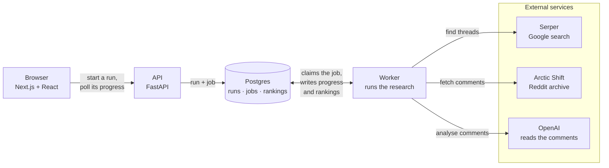
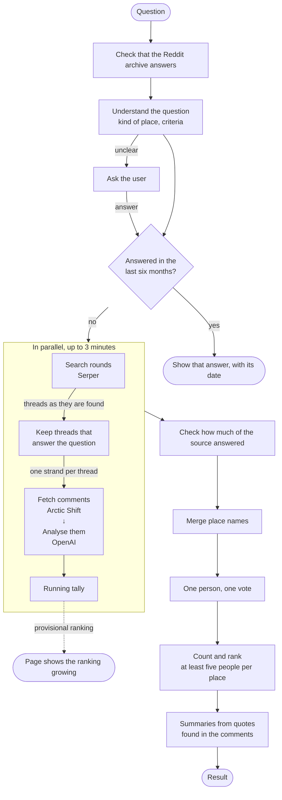

# TripFinder

**Ask a travel question. Get a ranking of what people on Reddit actually recommend.**

You type something like *"most underrated US states for nature"* or *"best national parks for
avoiding crowds"*. TripFinder finds the Reddit threads where people answered that question, reads
the comments, and counts which places they recommend. Each person counts once, however often they
mention a place.


The ranking is counted, not written by a model. A language model reads each comment and notes
which places it recommends, but the order comes from plain counting. Every number links back to
the comments behind it, and each summary only uses quotes that really appear in those comments.

---

## How it works

1. **Understands the question.** It works out what kind of place you mean (a state, a country, a
   national park) and asks you if that is unclear.
2. **Searches** for threads where people answer this kind of question, in a few rounds, each one
   guided by what the last one found.
3. **Picks the useful threads.** A thread where people answer the question counts. A thread that
   only talks about the topic, or that asks something easier ("best" instead of "underrated"),
   does not.
4. **Reads the comments.** For each one: which places it names, whether it recommends them, how
   strongly, and a short quote.
5. **Merges names.** *Canyonlands*, *Canyonlands NP* and *the Needles district* are one place. A
   built-in catalogue handles most of these; only the unclear ones need a model call.
6. **Counts.** One person, one vote per place. A place needs at least five different people
   before it shows up as a recommendation.
7. **Summarises** each result in a sentence or two, using only quotes from the counted comments.

The ranking appears while the comments are still being read and fills in as the run goes on. A
run has a three-minute time limit; if it hits the limit, everything read up to then is counted,
and the page says so.

**Asked before, answered instantly.** If the same question was answered in the last six months,
TripFinder shows that answer with its date instead of running again. "Research it again" is one
click away and always starts a fresh run.

Every result opens onto the comments it was counted from, grouped by thread:


[`PROJECT.md`](PROJECT.md) explains the reasoning behind the design, and
[`implementation-plan.md`](implementation-plan.md) is the build log.

---

## Running it

### You will need

- **Docker** (only for Postgres; everything else runs natively)
- **[uv](https://docs.astral.sh/uv/)**, which installs the right Python for you
- **Node 22+**

### Setup

```bash
git clone https://github.com/loukra/TripFinder.git
cd TripFinder
cp .env.example .env                      # see "API keys" below
cd backend && uv sync && cd ..            # installs Python 3.12 and the deps
cd frontend && npm install && cd ..
make db                                   # Postgres in Docker
make migrate                              # create the schema (once)
```

Then start three processes, each in its own terminal:

```bash
make api
```

```bash
make worker
```

```bash
make web
```

Open **http://localhost:3000**.

### API keys

A research run needs two services, both configured in `.env`:

| Variable | What for | Where | Cost |
|---|---|---|---|
| `OPENAI_API_KEY` | Reading the comments | [platform.openai.com](https://platform.openai.com) | pay-as-you-go |
| `SERPER_API_KEY` | Finding the threads (Google results) | [serper.dev](https://serper.dev) | 2 500 free queries, no card |

```dotenv
LLM_PROVIDER=openai
OPENAI_API_KEY=sk-...

SEARCH_PROVIDER=serper
SERPER_API_KEY=...
```

Both providers default to `fake`, so a fresh clone or a test run can never spend money by
accident. That also means a run without keys stops at its first model call. You can still start
everything, click through the UI and run the full test suite without any account. Restart
`make api` and `make worker` after changing `.env`.

**Reddit needs no key.** The comments come from
[Arctic Shift](https://arctic-shift.photon-reddit.com), a public Reddit archive.

**What a run costs.** One measured five-minute run read about 3 400 comments in roughly 125
analysis calls, plus about 30 more for everything else. There is no cost cap yet, so keep an eye
on your provider dashboard for the first few runs.

### Tests

```bash
make lint && make typecheck && make test
```

No test calls a real model or API. The integration tests start a temporary Postgres in Docker.
There is also a browser test: `cd frontend && npx playwright test`.

---

## Swapping the services

OpenAI and Serper each sit behind a small interface, so neither is hard-wired anywhere except one
factory function.

### A different search API

`WebSearchProvider` has one method:

```python
async def search(self, query: WebSearchQuery) -> Sequence[WebSearchHit]: ...
```

Implement it (Brave, Tavily, SerpAPI, Bing, your own index), add a value to `SearchProviderName`
and a branch to `build_search_provider` in `backend/src/tripfinder/search/factory.py`. Your
provider has to accept a `site:reddit.com` operator on every query.

### A different model

`LLMProvider` also has one method:

```python
async def complete_structured[T: BaseModel](self, *, prompt: str, response_model: type[T]) -> T: ...
```

Every call parses into a Pydantic model, so the provider needs structured output against a JSON
schema.

- **OpenAI-compatible APIs** (OpenRouter, Azure OpenAI, vLLM, Ollama, LM Studio) need no code: set
  `base_url` and `model` in `backend/src/tripfinder/ai/openai/config.py`.
- **Others** (Anthropic, Gemini, Bedrock): implement the interface and add a branch to
  `build_llm_provider` in `backend/src/tripfinder/ai/factory.py`.

### A different source than Reddit

`SourceAdapter` has three methods (`health_check`, `fetch_documents`, `fetch_comments`), and
nothing above it knows about Reddit. A forum or a review site would plug in the same way; you
would also register it where the pipeline is assembled.

---

## Architecture

### System overview

The web app and the research run separately. The API stores each run as a row and a job in
Postgres; a worker picks up the job, does the research and writes progress and rankings back,
which the page polls.



### One run, end to end

Searching, picking threads and reading comments do not wait for each other. Every useful thread
starts its own strand right away, while the search is still going, and a running tally turns what
has been read so far into the ranking the page shows.



The provisional rankings and the final one are computed by the same code, so the numbers on the
page only ever grow into the final answer.

### Code layout

```
frontend/   Next.js + React. Polls a run and shows the ranking as it grows.
backend/
  domain/      models, config, interfaces. No framework, no adapters.
  ranking/     the counting. Deterministic, no model, no I/O.
  analysis/    prompts and response schemas.
  pipeline/    the steps, concurrency, time limit, snapshots.
  sources/     Arctic Shift adapter.
  ai/ search/  provider implementations.
  api/         FastAPI.
  jobs/        Postgres-backed work queue.
```

`domain/` and `ranking/` import nothing from the adapters, and a test checks that.

---

## How it was built

Built by one developer with [Claude Code](https://claude.com/claude-code) as the coding agent.
[`PROJECT.md`](PROJECT.md) is the product and architecture brief, and
[`implementation-plan.md`](implementation-plan.md) splits it into numbered phases. Each phase ran
through [`/phase`](.claude/commands/phase.md): read the briefs, build that phase and nothing more,
pass lint, type checks and tests, then stop with a written report to review.
[`CLAUDE.md`](CLAUDE.md) holds the working agreement those sessions followed.

---

## Status

Working and usable, still in progress (currently Phase 14.10 of `implementation-plan.md`). Open
points: the time limit covers the analysis step rather than the whole run, and there is no cost cap
yet. Each run already records the tokens it used; turning that into a cost is the next step.

Issues and pull requests are welcome.
