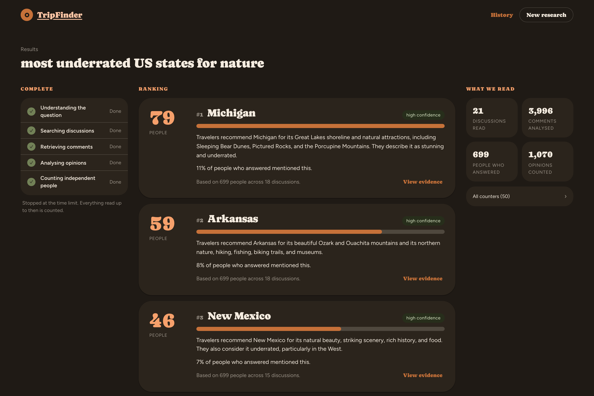
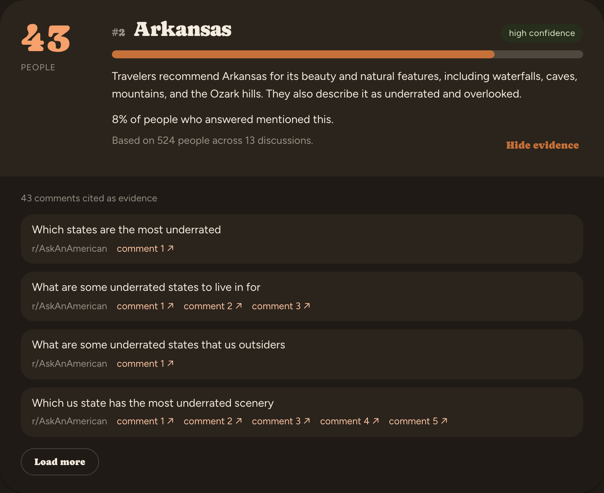
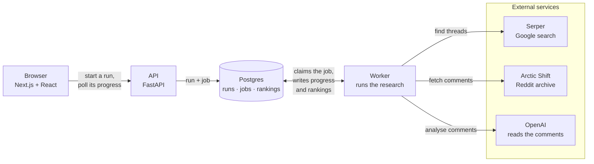

# TripFinder

TripFinder answers travel questions by counting what people recommend on Reddit.

You type something like *"most underrated US states for nature"* or *"best national parks for
avoiding crowds"*. TripFinder finds the Reddit threads where people answered that question, reads
the comments, and counts which places they recommend. Each person counts once, however often they
mention a place.



A language model reads each comment and notes which places it recommends. The ranking itself is
a plain count of those notes, and every result links to the comments behind it. The
short summary under each place only quotes text that actually appears in those comments.

---

## How it works

1. It works out what kind of place you mean (a state, a country, a national park) and asks you
   if that is unclear.
2. It searches for threads where people answer this kind of question. This happens in a few
   rounds, and each round uses what the previous one found.
3. It keeps the threads where people actually answer the question. A thread that only talks
   about the topic, or asks something easier ("best" instead of "underrated"), is skipped.
4. It reads the comments and notes, for each one, which places it names, whether it recommends
   them, how strongly, and a short quote.
5. It merges names that mean the same place, like *Canyonlands*, *Canyonlands NP* and *the
   Needles district*. A built-in catalogue handles most of these, and only the unclear ones need
   a model call.
6. It counts. Each person gets one vote per place, and a place needs at least five different
   people before it is listed as a recommendation.
7. It writes a sentence or two about each result, quoting only the counted comments.

You can watch the ranking build up while the comments are still being read. Reading is limited to
three minutes. Everything read until then is counted, and the page mentions when the time limit
was reached.

If someone asked the same question in the last six months, TripFinder shows that earlier answer
with its date instead of running again. A "Research it again" button starts a fresh run anyway.

Click "View evidence" on a result to see the comments it was counted from, grouped by thread:



[`PROJECT.md`](PROJECT.md) explains the reasoning behind the design, and
[`implementation-plan.md`](implementation-plan.md) is the build log.

---

## Running it

### You will need

- **Docker** (only for Postgres, everything else runs natively)
- **[uv](https://docs.astral.sh/uv/)**, which installs the right Python for you
- **Node 22+**

### Setup

```bash
git clone https://github.com/loukra/TripFinder.git
cd TripFinder
cp .env.example .env                      # see "API keys" below
cd backend && uv sync && cd ..            # installs Python 3.12 and the deps
cd frontend && npm install && cd ..
make db                                   # Postgres in Docker
make migrate                              # create the schema (once)
```

Then start three processes, each in its own terminal:

```bash
make api
```

```bash
make worker
```

```bash
make web
```

Open **http://localhost:3000**.

### API keys

A research run needs two services, both configured in `.env`:

| Variable | What for | Where | Cost |
|---|---|---|---|
| `OPENAI_API_KEY` | Reading the comments | [platform.openai.com](https://platform.openai.com) | pay-as-you-go |
| `SERPER_API_KEY` | Finding the threads (Google results) | [serper.dev](https://serper.dev) | 2 500 free queries, no card |

```dotenv
LLM_PROVIDER=openai
OPENAI_API_KEY=sk-...

SEARCH_PROVIDER=serper
SERPER_API_KEY=...
```

Both providers default to `fake`, so a fresh clone or a test run never spends money by accident.
Without keys, a research run stops at its first model call, but you can still start everything,
click through the UI and run the full test suite. Restart `make api` and `make worker` after
changing `.env`.

Reddit itself needs no key. The comments come from
[Arctic Shift](https://arctic-shift.photon-reddit.com), a public Reddit archive.

As a rough idea of cost: one five-minute run I measured read about 3 400 comments in roughly 125
analysis calls, plus about 30 more for everything else. There is no cost cap yet, so check your
provider dashboard after the first few runs.

### Tests

```bash
make lint && make typecheck && make test
```

No test calls a real model or API. The integration tests start a temporary Postgres in Docker.
There is also a browser test: `cd frontend && npx playwright test`.

---

## Swapping the services

OpenAI and Serper each sit behind a small interface. The only place either is named is a factory
function.

### A different search API

`WebSearchProvider` has one method:

```python
async def search(self, query: WebSearchQuery) -> Sequence[WebSearchHit]: ...
```

Implement it (Brave, Tavily, SerpAPI, Bing, your own index), add a value to `SearchProviderName`
and a branch to `build_search_provider` in `backend/src/tripfinder/search/factory.py`. Your
provider has to accept a `site:reddit.com` operator on every query.

### A different model

`LLMProvider` also has one method:

```python
async def complete_structured[T: BaseModel](self, *, prompt: str, response_model: type[T]) -> T: ...
```

Every call parses into a Pydantic model, so the provider needs structured output against a JSON
schema.

- **OpenAI-compatible APIs** (OpenRouter, Azure OpenAI, vLLM, Ollama, LM Studio) need no code: set
  `base_url` and `model` in `backend/src/tripfinder/ai/openai/config.py`.
- **Others** (Anthropic, Gemini, Bedrock): implement the interface and add a branch to
  `build_llm_provider` in `backend/src/tripfinder/ai/factory.py`.

### A different source than Reddit

`SourceAdapter` has three methods (`health_check`, `fetch_documents`, `fetch_comments`), and
nothing above it knows about Reddit. A forum or a review site would plug in the same way. You
would also have to register it where the pipeline is assembled.

---

## Architecture

### System overview

The web app and the research run as separate processes. The API stores each run as a row and a
job in Postgres. A worker picks up the job, does the research and writes its progress and
rankings back, and the page polls the API for them.



### One run, end to end

Searching, picking threads and reading comments run at the same time. As soon as a useful thread
turns up, it gets its own strand that fetches and analyses its comments, even while the search is
still going. A running tally turns everything read so far into the ranking you see on the page.


The rankings shown during the run and the final one are computed by the same code, so the final
ranking is simply the last one in that series.

### Code layout

```
frontend/   Next.js + React. Polls a run and shows the ranking as it grows.
backend/
  domain/      models, config, interfaces. No framework, no adapters.
  ranking/     the counting. Deterministic, no model, no I/O.
  analysis/    prompts and response schemas.
  pipeline/    the steps, concurrency, time limit, snapshots.
  sources/     Arctic Shift adapter.
  ai/ search/  provider implementations.
  api/         FastAPI.
  jobs/        Postgres-backed work queue.
```

`domain/` and `ranking/` import nothing from the adapters, and a test checks that.

---

## How it was built

I built TripFinder on my own, with [Claude Code](https://claude.com/claude-code) as the coding
agent. [`PROJECT.md`](PROJECT.md) is the product and architecture brief, and
[`implementation-plan.md`](implementation-plan.md) splits it into numbered phases. Each phase ran
through [`/phase`](.claude/commands/phase.md), which reads the briefs, builds that one phase, runs
lint, type checks and tests, and ends with a written report that I review.
[`CLAUDE.md`](CLAUDE.md) holds the working agreement those sessions followed.

---

## Status

It works and is usable, but it is still in progress (currently Phase 14.10 of
`implementation-plan.md`). Two things are still open: the time limit only covers the analysis
step rather than the whole run, and there is no cost cap yet. Each run already records the tokens
it used, and turning that into a cost is the next step.

Issues and pull requests are welcome.
